# House Price Prediction

End-to-end regression project on the **Ames Housing** dataset (1,460 houses, 80 raw
features) to predict `SalePrice`. The pipeline covers cleaning, feature engineering,
leakage-safe preprocessing, cross-validated model selection over five learned
models plus two naive baselines, and evaluation with domain metrics plus
feature-importance analysis.

**Headline result:** the CV-tuned `HistGradientBoostingRegressor` cuts holdout RMSE
from **$80,068 → $23,960 (−70.1%)** and MAE from **$57,819 → $16,068 (−72.2%)**
against a mean-prediction baseline, reaching **R² = 0.910** on a 20% holdout that was
never touched during model selection. On a stricter *out-of-time* split — trained on
2006–2007 sales, tested on 2008–2010 — it still scores **$26,274 (R² = 0.883)**
(§3.8), so the headline is not an artefact of the random split.

---

## 1. Dataset

| | |
|---|---|
| Source | Kaggle *House Prices – Advanced Regression Techniques* (Ames, Iowa), retrieved via OpenML dataset `house_prices` (id 42193) |
| Size | 1,460 rows × 80 feature columns + 1 target (`SalePrice`) |
| Feature mix | 79 raw feature columns (36 numeric, 43 categorical) → **87** after type handling and 8 engineered features (43 numeric, 44 categorical) |
| Missing values | 19 columns, from 0.07% (`Electrical`, 1 row) to 99.5% (`PoolQC`, 7 rows with a pool) |
| Target | Mean $180,921, SD $79,443, min $34,900, max $755,000, **skew 1.88**, kurtosis 6.54 |
| Period | Sales 2006–2010, single city |

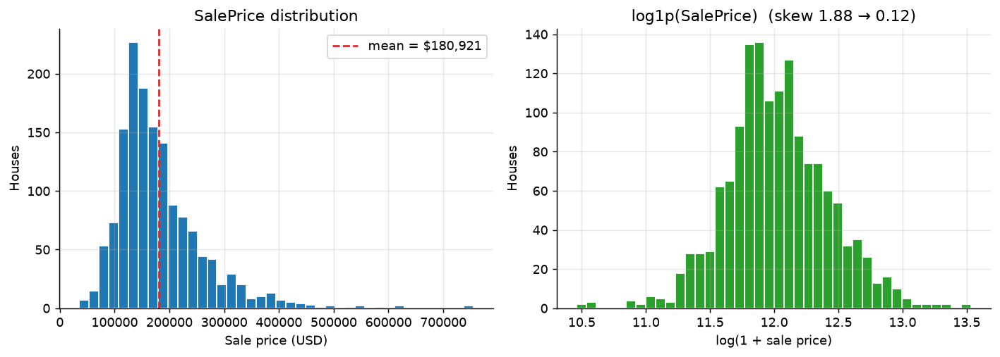

The raw CSV is committed at `data/raw/ames_housing.csv` and can be re-downloaded
with `python scripts/download_data.py`.

---

## 2. Methodology

### 2.1 Zero-target-leakage controls

Every requirement below is enforced structurally, not by convention:

1. **All statistics live inside the pipeline.** Imputation medians, most-frequent
   categories, the one-hot vocabulary, the scaler's mean/SD and the variance
   threshold are fit by `ColumnTransformer`/`Pipeline` — `GridSearchCV` refits the
   *entire* pipeline on each training fold, so no held-out fold ever influences its
   own preprocessing.
2. **One holdout, touched once.** The 20% test set is used only for the final
   reported numbers; hyper-parameters are chosen by 5-fold CV on the training split.
3. **No target-derived features.** The target never enters `X`; derived features
   (`TotalSF`, `TotalBath`, `HouseAge`, …) are computed row-by-row from other
   columns of the same row.
4. **Cleaning rules are documentation-driven, not data-driven.** The "NA means the
   feature is absent" mapping comes from the official Ames data dictionary and is a
   per-row operation (no statistics from other rows).
5. **Sale-context sensitivity check.** Features that only exist *at* sale time
   (`MoSold`, `YrSold`, `SaleType`, `SaleCondition`) are ablated and reported —
   see §3.7. Dropping them moves holdout RMSE by **+1.1%** while *lowering* MAE
   by 2.2%: a ±1% swing in either direction, so no part of the score rests on
   them.
6. **Deterministic protocol.** Single `random_state = 42` everywhere (split, CV
   folds, forest, boosting, permutation importance) for exact reproducibility.

### 2.2 Cleaning (row-wise, pre-split)

* `Id` dropped — a row identifier carries no signal.
* **Documented NA semantics**: for 15 columns (`PoolQC`, `Alley`, `Fence`,
  `FireplaceQu`, `Garage*`, `Bsmt*`, `MiscFeature`, `MasVnrType`) `NaN` means *the
  feature is absent*, so it is recoded to the literal level `"None"` instead of
  being imputed. `MasVnrArea` NaN → `0` (no veneer). This keeps "no basement" as a
  meaningful category rather than a missing value.
* `MSSubClass` is an integer **code** for the dwelling type, not a quantity — cast
  to categorical so one-hot encoding does not invent a false ordering.
* A `LotFrontage_is_missing` indicator is added *before* imputation (17.7% of rows
  are missing it), so the missingness pattern itself stays available as a signal.
* Remaining genuine missingness (`LotFrontage` 259, `GarageYrBlt` 81,
  `Electrical` 1) is left NaN and imputed **inside the pipeline**.

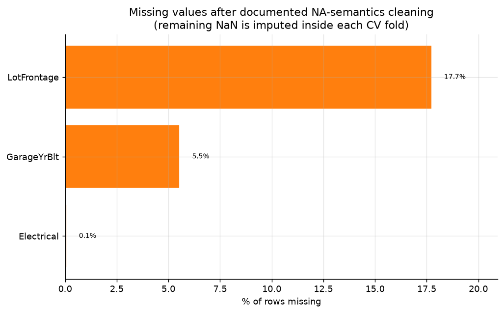

### 2.3 Feature engineering

| Derived feature | Definition | Rationale |
|---|---|---|
| `TotalSF` | `TotalBsmtSF + 1stFlrSF + 2ndFlrSF` | total finished area, the classic price driver |
| `TotalBath` | `FullBath + 0.5·HalfBath + BsmtFullBath + 0.5·BsmtHalfBath` | half-baths count less than full baths |
| `HouseAge` | `YrSold − YearBuilt` | age at sale |
| `YearsSinceRemod` | `YrSold − YearRemodAdd` | recency of remodeling |
| `TotalPorchSF` | sum of the four porch columns | outdoor living space |
| `LogLotArea`, `LogGrLivArea` | `log1p(...)` | compresses the heavy right tail of size predictors |

### 2.4 Preprocessing (identical for every model except scaling)

```
numeric:     median imputation ──▶ StandardScaler (linear models only)
categorical: most-frequent imputation ──▶ OneHotEncoder(handle_unknown='ignore',
                                            min_frequency=5, drop='first')
                                     ──▶ VarianceThreshold(0.01)
```

* **Encoding** — one-hot for all models so that no model sees a fake ordinal
  ordering of nominal categories; `handle_unknown='ignore'` makes unseen test
  categories safe (they map to the dropped baseline level); levels seen in fewer
  than 5 training rows are pooled.
* **Scaling** — applied only to linear models (trees are scale-invariant).
* **Near-zero-variance filter** — encoded columns that are non-zero in fewer than
  ~1% of training rows are dropped. This is *required* for stability: only **7**
  houses in the dataset have a pool, and unregularised regression assigned those
  rare indicators coefficients of **+41.8 and +16.6 log-price units** from a
  handful of examples, producing predictions of $10¹⁵ (§5.1). The threshold is
  evaluated per fold, so it is leakage-safe.

### 2.5 Split & validation protocol

* **80/20 holdout stratified on price deciles** (1,168 train / 292 test). Decile
  stratification keeps the small holdout representative — its price SD is $80.2k
  against $79.4k for the population. (Quartile stratification was tried first and
  left 5 of the 10 most expensive houses in the holdout, inflating its spread by
  ≈20%.)
* **5-fold shuffled K-fold CV on the training split** for model selection and for
  the comparison table; `refit` on the best mean CV RMSE.
* Metrics are always computed **in dollars** on the original scale.

### 2.6 Target transform

`SalePrice` is right-skewed (skew 1.88), so all learned models are wrapped in
`TransformedTargetRegressor(func=log1p, inverse_func=expm1)`: they train on
log-price and are inverse-transformed before scoring. This reduces the leverage of
the most expensive houses on the squared-error loss. The two baselines are fitted
directly on dollars (the mean is the RMSE-optimal constant, the median the
MAE-optimal one), which keeps the baseline comparison honest.

### 2.7 Models & tuning

| Model | Estimator | Tuned by CV |
|---|---|---|
| `baseline_mean` | `DummyRegressor(mean)` | — |
| `baseline_median` | `DummyRegressor(median)` | — |
| `linear_regression` | `LinearRegression` (OLS) | — |
| `ridge` | `Ridge` | `alpha ∈ {0.1 … 1000}` |
| `decision_tree` | `DecisionTreeRegressor` | `max_depth ∈ {4…12, None}` × `min_samples_leaf ∈ {1,2,5,10}` |
| `random_forest` | `RandomForestRegressor` (400 trees) | `max_features ∈ {0.5, 'sqrt'}` × `min_samples_leaf ∈ {1,2,4}` |
| `hist_gradient_boosting` | `HistGradientBoostingRegressor` (300 boosting stages) | `learning_rate ∈ {0.05, 0.1}` × `max_leaf_nodes ∈ {15, 31}` × `l2_regularization ∈ {0, 1}` |

Selected hyper-parameters: **HGBR** `learning_rate=0.1`, `max_leaf_nodes=15`,
`l2_regularization=0`; **RF** `max_features=0.5`, `min_samples_leaf=1`;
**tree** `max_depth=12`, `min_samples_leaf=10`; **Ridge** `alpha=0.1`.

---

## 3. Results

### 3.1 Comparison against the baseline

5-fold CV (train split) and the untouched 20% holdout:

| Model | CV RMSE | CV MAE | CV R² | **Test RMSE** | **Test MAE** | **Test R²** | Test p90 \|err\| |
|---|---:|---:|---:|---:|---:|---:|---:|
| **hist_gradient_boosting** | 27,805 ± 2,529 | 16,636 | **0.876** | **23,960** | 16,068 | **0.910** | 35,639 |
| random_forest | 30,607 ± 3,125 | 17,439 | 0.850 | 24,413 | **15,073** | 0.907 | **35,264** |
| linear_regression | 33,860 ± 9,160 | 17,169 | 0.798 | 26,233 | 16,643 | 0.893 | 36,137 |
| ridge | 33,868 ± 9,280 | 17,109 | 0.797 | 26,144 | 16,604 | 0.893 | 35,667 |
| decision_tree | 38,566 ± 2,511 | 24,613 | 0.756 | 34,803 | 23,382 | 0.811 | 49,429 |
| *baseline_mean* | 79,076 ± 6,383 | 57,420 | −0.004 | 80,068 | 57,819 | −0.000 | 108,732 |
| *baseline_median* | 81,245 ± 6,412 | 55,651 | −0.061 | 82,001 | 55,819 | −0.049 | 117,900 |

**Improvement over the mean baseline (holdout): RMSE −70.1%, MAE −72.2%, R² 0.000 → 0.910.**
RMSLE likewise drops from 0.418 to 0.127, and the 90th-percentile absolute error
falls from $108.7k to $35.6k — the gain is not an artefact of the metric chosen.

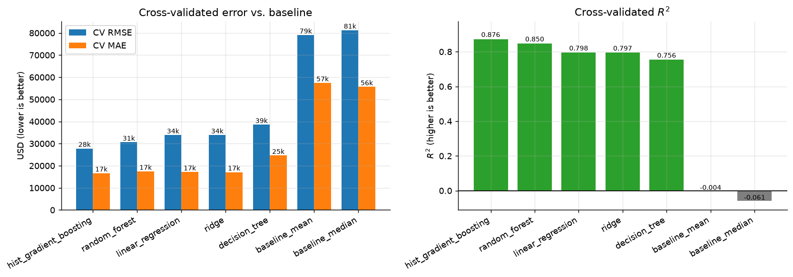

Reading the table: a *single* decision tree is the weakest learned model (it
overfits; CV RMSE $38.6k), and bagging 400 trees removes most of that variance
(CV RMSE → $30.6k). Gradient boosting improves on the *forest* again — $30.6k →
$27.8k (−9%) — because it fits each stage to the *residuals* of the previous
ones instead of averaging independent trees. The two ensembles are close enough that the metrics disagree
on which is better: boosting wins on RMSE and R², while the forest still holds
the best MAE ($15,073 vs $16,068) and the best p90 |error|. With CV standard
deviations of ±$2.5k and ±$3.1k on a single 292-row holdout, that gap is *not*
decisive — treat them as tied and pick on secondary criteria (see §5.4). The
linear models are within ~9% of the winner on the holdout (~22% by CV), which
says the signal in this dataset is largely additive; the ensembles' edge comes
from interactions (e.g. quality × size × age) and from the heavy tails that OLS
penalises disproportionately.

### 3.2 Actual vs. predicted

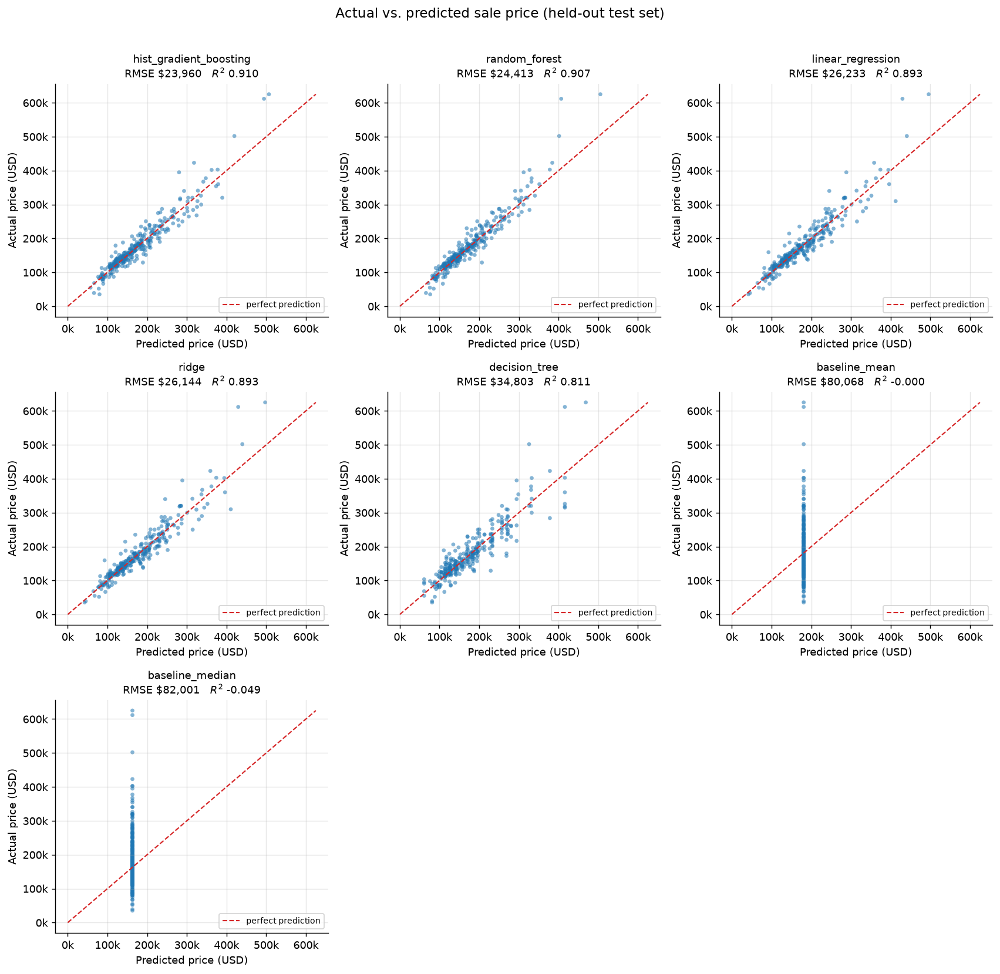

All learned models track the identity line closely through the dense $100k–$300k
region; the two constant baselines collapse to a vertical stripe, as expected.

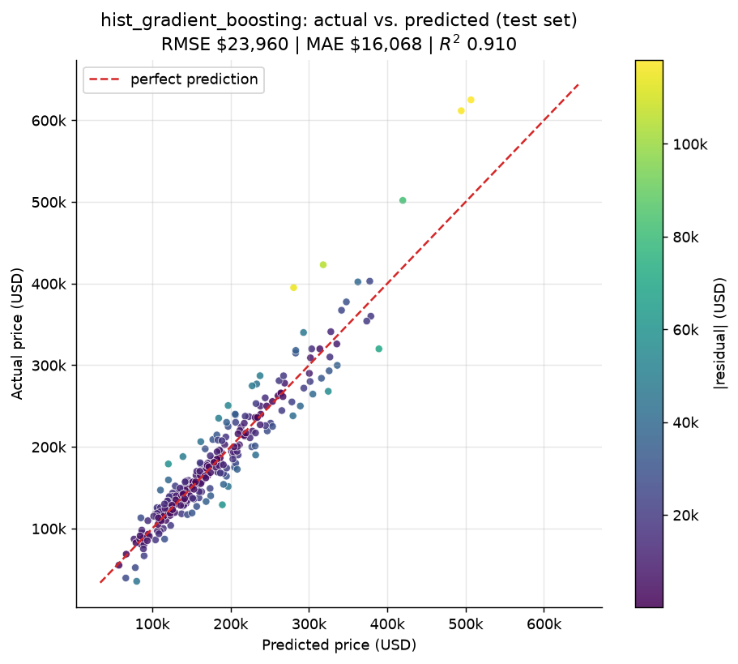

### 3.3 Residual diagnostics (best model)

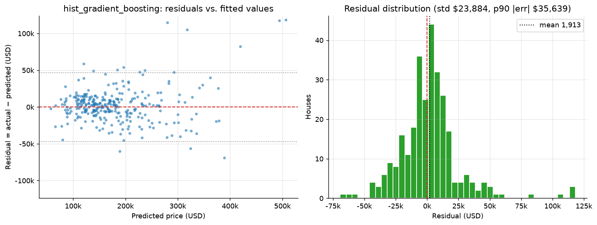

* Mean residual **+$1,913** — essentially unbiased on average (the forest's was
  +$3,748).
* Residual SD $23.9k; distribution is right-tailed: a handful of misses above
  $100k dominate the RMSE (the single worst case is **+$118k**, an expensive
  house the model put at $507k).
* The fan shape (wider spread above ~$250k predicted) shows mild
  heteroscedasticity that the log-target only partly removes.

### 3.4 Error by price segment (failure-case evidence)

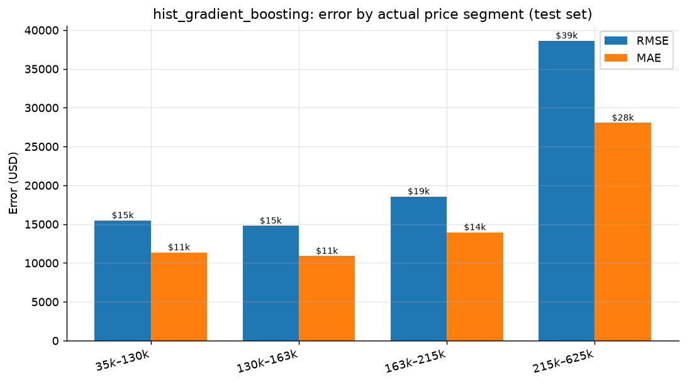

| Actual price segment | n | RMSE | MAE |
|---|---:|---:|---:|
| $35k–$130k | 73 | $15.5k | $11.4k |
| $130k–$163k | 73 | $14.8k | $10.9k |
| $163k–$215k | 73 | $18.6k | $13.9k |
| **$215k–$625k** | 73 | **$38.6k** | **$28.1k** |

Error is roughly flat across the bottom three quartiles ($14.8k–$18.6k) and
**2.4× higher in the top quartile** ($38.6k vs a $16.3k average) — the model is
far less reliable for expensive properties. This is the most consistent failure
mode in the project: it appears for the forest, for boosting and for OLS alike
(§5.2).

### 3.5 Feature importance

**Permutation importance on the holdout** (increase in RMSE when a raw feature is
shuffled — model-agnostic and computed at the original-feature level):

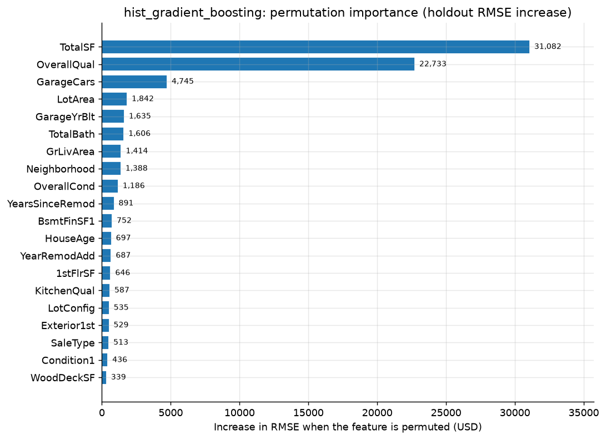

`TotalSF` (+$31.1k RMSE when permuted) and `OverallQual` (+$22.7k) dominate by an
order of magnitude; `GarageCars` (+$4.7k), `LotArea`, `GarageYrBlt`, `TotalBath`
and `GrLivArea` follow, but every feature after the top two is worth less than
$5k of RMSE. This matches domain knowledge about housing prices and validates
that the engineered features are doing real work (`TotalSF`, `TotalBath`,
`HouseAge` and `YearsSinceRemod` all appear in the top 15).

**Impurity-based importance** aggregated over one-hot columns back to their
source feature. Not every estimator exposes `feature_importances_` — gradient
boosting and the linear models do not — so the chart is drawn from the best
model in the run that does. With boosting winning here, that is the **forest**
(the figure is titled `random_forest`):

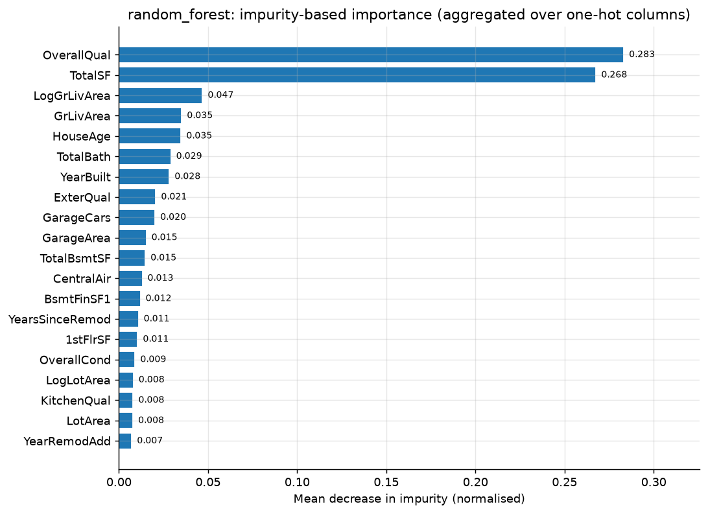

The two views broadly agree: both put `OverallQual` and `TotalSF` far ahead of
everything else and share the same supporting cast (`TotalBath`, `HouseAge`,
`GrLivArea`, `GarageCars`). They differ in ordering — impurity puts quality
first, permutation puts size first — and impurity splits credit across the
correlated `GrLivArea`/`LogGrLivArea` pair. Permutation importance is the more
trustworthy of the two because impurity importance is biased towards
high-cardinality features and towards features with many split points.

**Ridge coefficients** (standardised, log-price scale) for the linear model:

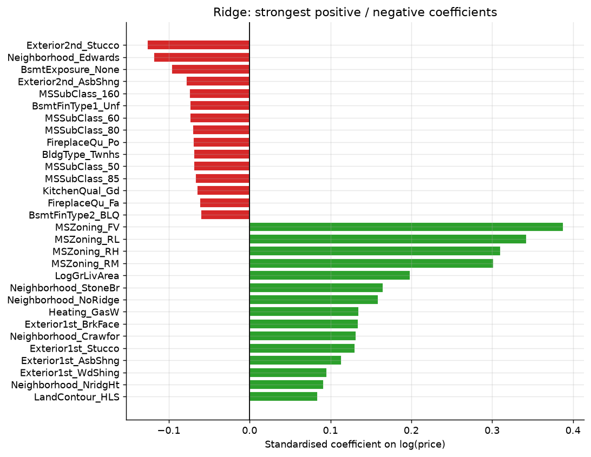

Zoning (`MSZoning_FV/RL/RH/RM`) and the premium neighborhoods
(`Neighborhood_StoneBr`, `NoRidge`, `Crawfor`) push price up, while stucco
exteriors, `Neighborhood_Edwards` and unfinished basements push it down — all
consistent with local market knowledge. Note that each dummy coefficient is
*relative to the encoder's dropped reference level*, not an absolute effect.

### 3.6 Generalisation

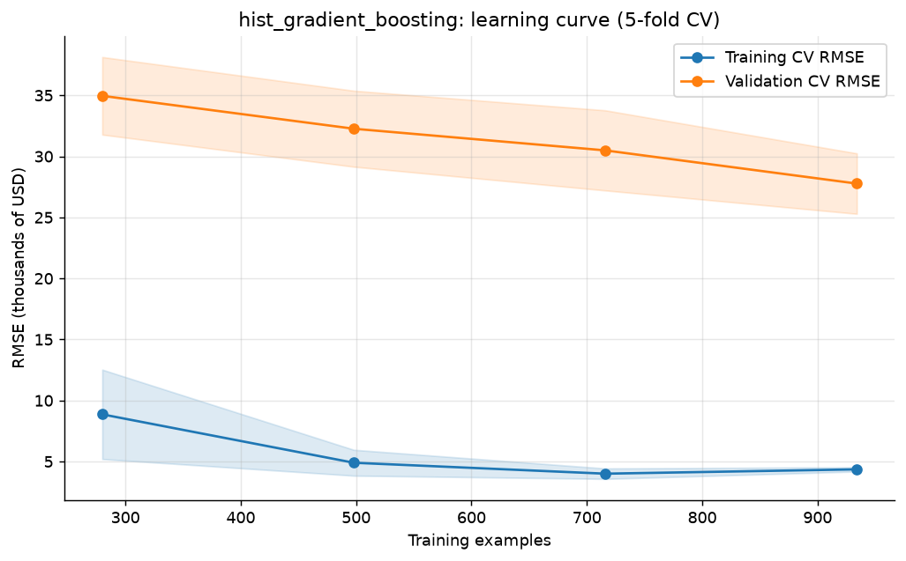

* Training CV RMSE falls $8.9k → $4.4k and validation CV RMSE $35.0k → $27.8k
  as the training set grows from 280 to 934 rows.
* **The validation curve is still descending** at the right edge: more labelled
  data would improve the model more than further hyper-parameter tuning.
* The generalisation gap is wide and *widening in relative terms*: at full size
  the boosted model reaches ~$4.4k RMSE on its own training folds against
  $27.8k on validation folds. 300 boosting stages with `max_leaf_nodes = 15`
  can fit the training folds almost exactly, so the fit is **data-limited, not
  capacity-limited** — more rows, not a bigger model, is the fix.
* Holdout ($24.0k) is ~$3.8k better than mean CV ($27.8k), i.e. this particular
  292-row split is somewhat easier than the average CV fold; CV ± $2.5k and the
  per-segment errors in §3.4 are the more reliable guide to expected error.

### 3.7 Leakage-sensitivity ablation

| Configuration | Test RMSE | Test MAE | Test R² |
|---|---:|---:|---:|
| Full feature set | $23,960 | $16,068 | 0.910 |
| Without `MoSold`, `YrSold`, `SaleType`, `SaleCondition` | $24,235 | **$15,716** | 0.908 |

Dropping every sale-context feature costs 1.1% of RMSE while *improving* MAE by
2.2%: sale timing helps a little in the expensive tail (where squared error is
concentrated) and hurts slightly on typical houses. Either way the swing is
≈1%, so the model's performance rests on the physical attributes of the house,
not on information that is only available once the sale has happened. This
directly addresses the risk that the reported score is an artefact of features
that would not exist at prediction time.

### 3.8 Out-of-time (temporal) evaluation

The headline protocol randomises rows across 2006–2010, so a house sold in 2009
can sit in training while a 2006 sale is held out. The stricter question — *will
it work on houses that sold later than anything it was trained on?* — is
answered by refitting the same pipeline (same hyper-parameters, no re-tuning) on
**643 sales from 2006–2007** and evaluating on **817 sales from 2008–2010**:

| Configuration | RMSE | MAE | R² |
|---|---:|---:|---:|
| Mean-prediction baseline | $76,934 | $57,476 | −0.006 |
| **Winner, full features** | **$26,274** | $17,156 | **0.883** |
| Winner, without sale context | $26,379 | $17,081 | 0.882 |

* The out-of-time RMSE is **+9.7%** worse than the random-split score
  ($26,274 vs $23,960) — still **65.9% below the baseline** in the same split.
* Two things change at once, so this is an *upper bound* on pure temporal
  drift: the training set shrinks from 1,168 to 643 rows (−45%), and the test
  period covers the 2008–2010 housing crash. The learning curve in §3.6 says
  less data alone would cost several thousand dollars of RMSE.
* `YrSold = 2008/2009/2010` lies **outside the training range**, and one sale
  type (`SaleType = 'Con'`) never occurs in 2006–2007 — so both the encoder's
  `handle_unknown='ignore'` path and out-of-range numeric extrapolation are
  genuinely exercised here, and the score still holds.
* Sale context is just as unimportant out of time: dropping it changes RMSE by
  **+0.4%**.

This is the number to trust for a deployment that predicts future sales; the
random-split figure is reported for comparability with the standard benchmark
protocol.

---

## 4. Assumptions

1. **Prediction time = sale time.** All features are assumed known when a price
   is predicted. If the use case is *pre-sale appraisal*, `MoSold`, `YrSold`,
   `SaleType` and `SaleCondition` must be dropped (§3.7 shows that costs ≈1% of
   RMSE and *improves* MAE).
2. **Data-dictionary NA semantics.** "NA" in pool/basement/garage/fence columns
   means *absent*, not *unknown*. If a value were genuinely unknown instead, the
   current encoding would mislabel it as "no feature".
3. **Missingness handling.** `LotFrontage` and `GarageYrBlt` are assumed missing
   at random given the other features; a median impute plus an explicit
   missingness indicator is used. The 8 rows missing both `MasVnrType` and
   `MasVnrArea` are assumed to have no masonry veneer (0.5% of rows).
4. **Stationarity.** Prices are assumed drawn from one market (Ames 2006–2010).
   No macroeconomic or temporal drift is *modelled*; instead §3.8 measures what
   the 2008–2010 regime costs out of time (+9.7% RMSE).
5. **Log-scale modelling.** Errors are optimised on log-price but reported in
   dollars; this trades a small bias on the cheapest houses for stability at the
   top of the distribution.
6. **Rare categories are pooled** (<5 rows) and rare encoded features dropped
   (<1% of rows) on the assumption that their individual effects cannot be
   estimated reliably from so few examples.

---

## 5. Limitations, failure cases and known issues

### 5.1 Unregularised OLS was numerically unstable (documented failure)

Plain `LinearRegression` is included as a model, and it required two standard
stabilisation steps to be usable at all:

* The raw design matrix (1,168 × 292) had **rank 236 and condition number
  3.6 × 10³²** — the one-hot dummy trap plus exactly-collinear derived features
  (`TotalSF` = its three components, `HouseAge` = `YrSold − YearBuilt`, …).
* Worse, rare features got extreme coefficients from a handful of examples:
  `PoolArea` (non-zero in **2** training rows of one fold) received a coefficient
  of **+41.8 log-price units** and `PoolQC` **+16.6**, so a single house with a
  pool was predicted at **$1.7 × 10¹⁶**. One CV fold reported RMSE ≈ $10¹⁵.

Fixes applied: `drop='first'` in the encoder (removes the dummy trap) and
`VarianceThreshold(0.01)` (removes sub-1% indicators). OLS then becomes stable
(CV RMSE $33.9k) and competitive. **The lesson stands: on this feature set,
unregularised regression is one rare category away from catastrophic
extrapolation — Ridge is the safe linear default.** Notably CV then selected only
`alpha = 0.1`, i.e. after the rare-feature fix almost no regularisation is needed.

### 5.2 Expensive houses are systematically under-predicted

The top price quartile has RMSE **$38.6k** vs $14.8–18.6k for the rest (§3.4),
and the winning boosted model tops out at **$507k** for test houses that sold at
**$625k and $611k** — misses of +$118k and +$117k, the two largest residuals in
the run. The forest behaves identically ($505k). **Tree models — boosted or
bagged — are piecewise constant: they cannot extrapolate beyond the target
region covered by training data**, so they regress towards the mean exactly
where absolute errors are largest (a rare combination of size, quality and
location sits in a leaf populated by cheaper houses). The ceiling is behavioural
rather than a hard cap: training *does* contain a $755k sale, yet neither
ensemble exceeds $507k on the holdout. A log-target mitigates but does not
remove this. Linear models extrapolate more freely and post a lower
RMSLE (Ridge 0.1216 vs 0.1269 for the winner) despite a worse RMSE.

### 5.3 Data and scope limitations

* **Small, single-market dataset** (1,460 rows, one city, 2006–2010). Results do
  not transfer to other regions or to current prices without retraining; no
  external validation set exists.
* **The headline number comes from a random split.** Houses sold in 2007 can
  appear in training while 2006 sales are held out, so the $24.0k headline is
  optimistic for a deployment that predicts future sales. §3.8 measures it
  directly — **$26,274 (+9.7%)**, training on 2006–2007 and testing on
  2008–2010. That comparison mixes regime drift with a training set that is 45%
  smaller, so it is an upper bound on pure drift *and* the number to quote for
  production.
* **Two well-known outlier rows** (very large living area sold cheaply) remain in
  the data. Removing them after inspecting the target would be a form of
  cherry-picking, so they are kept; they mostly hurt the linear models.
* **Single holdout uncertainty.** With 292 test rows the holdout RMSE itself has
  meaningful sampling noise; CV standard deviations (±$2.5k for the winner,
  ±$3.1k for the forest) are reported alongside for that reason.
* **Categorical cardinality vs. sample size.** ~255 encoded columns for 1,168
  training rows (198 after the variance filter) means many levels are supported
  by only a handful of examples; `min_frequency` and `VarianceThreshold` trade
  away rare-level detail for stability (e.g. a real but rare pool signal is
  discarded).

### 5.4 Other caveats

* **Impurity importance is biased** towards continuous/high-cardinality features;
  permutation importance on the holdout is the primary interpretation.
* **Only two forest hyper-parameters were tuned** (budget); `n_estimators` was
  fixed at 400 and no `max_depth` limit. Gradient boosting *is* included now
  (§3.1) — its three-parameter grid is likewise a budget choice — but no
  stacking/blending of the top models was attempted, which would likely buy
  another point or two of R² at the cost of interpretability.
* **Metrics are in dollars on a skewed target**, so RMSE is dominated by the
  expensive tail; RMSLE and per-segment errors are reported to compensate.
* **Leakage coverage** is verified structurally (§2.1) and via the sale-context
  ablation, but no claim can be made about leakage that might exist in the
  source data itself (e.g. appraisals derived from the sale price).

---

## 6. How to run

```bash
pip install -r requirements.txt
python scripts/download_data.py   # optional: re-fetch data/raw/ames_housing.csv
python -m src.train               # ~4 min, CPU only — trains, evaluates, writes reports
```

Outputs:

```
reports/metrics.json          metrics for every model + baseline gain + ablation + temporal split
reports/cv_results.csv        one row per model (CV and holdout scores)
reports/test_predictions.csv  holdout predictions of all seven models
reports/best_model.joblib     fitted winning pipeline (preprocessing + model)
reports/figures/*.png         every chart embedded in this README
```

The run is fully deterministic (`random_state = 42` for the split, CV folds,
forest, boosting and permutation importance). Two consecutive runs produced
byte-identical `test_predictions.csv` and identical metrics — only the recorded
`fit_seconds` fields differ.

### Scoring new rows

`python -m src.train` saves the *fitted* pipeline — imputation, one-hot
encoding, the variance filter and the model together — so a new house can be
scored without retraining and without refitting anything on the scoring data:

```bash
python -m src.predict                          # demo: 5 rows from the untouched holdout
python -m src.predict --input my_houses.csv    # score a raw Ames-format CSV
python -m src.predict --input my_houses.csv --output predictions.csv
```

The input must carry the raw Ames columns (`Id` and `SalePrice` are optional;
anything extra is ignored). Missing required columns are reported by name
rather than failing deep inside the pipeline. `--rows N` / `--start K` select a
different slice for the demo mode, and `--model PATH` scores with a different
artifact.

### Project structure

```
├── data/raw/ames_housing.csv        dataset (1,460 × 81)
├── scripts/download_data.py         data acquisition
├── src/
│   ├── config.py                    paths, seeds, documented NA semantics
│   ├── data.py                      loading, row-wise cleaning, feature engineering, split
│   ├── preprocess.py                leakage-safe ColumnTransformer builders
│   ├── models.py                    model registry + hyper-parameter grids
│   ├── evaluate.py                  metrics and all plotting code
│   ├── train.py                     entry point: selection, evaluation, reports
│   └── predict.py                   inference CLI using the saved pipeline
├── reports/                         metrics, tables, figures, fitted model
├── requirements.txt
└── README.md
```

### Requirements

Python 3.12 · numpy 2.5 · pandas 3.0 · scikit-learn 1.9 · matplotlib 3.11 · joblib 1.6
